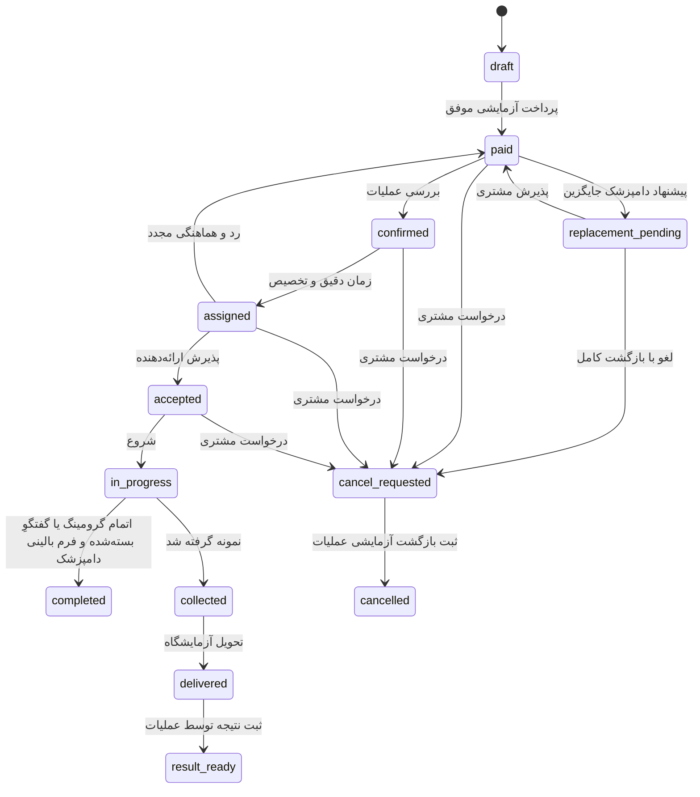

# جریان‌ها و وضعیت‌ها

هر سه خدمت: پیش‌نویس → اطلاعات پت → متخصص/جزئیات نمونه → بازه و هزینه → ورود → پرداخت آزمایشی → صف عملیات.

## وقت و قیمت

بازه‌ها صبح ۹–۱۲، ظهر ۱۲–۱۵، عصر ۱۵–۱۸ و شب ۱۸–۲۱ هستند. در seed برخی بازه‌ها عمداً موجود نیستند. برای دامپزشک/گرومر انتخاب‌شده، فقط ظرفیت همان ارائه‌دهنده نمایش داده می‌شود. گونه و پوشش محله بررسی می‌شوند. رزروهای لغوشده یا در صف کنسلی ظرفیت نگه نمی‌دارند. تایم دقیق باید آینده باشد و عملیات فقط در availability دارای ظرفیت تخصیص می‌دهد.

گرومینگ جمع آیتم‌های انتخابی است؛ آیتم نامعتبر یا تکراری رد می‌شود. دامپزشکی از تعرفهٔ ارائه‌دهنده و نمونه‌برداری از کاتالوگ نمونه قیمت می‌گیرند. مبلغ فرم کلاینت نادیده گرفته می‌شود.

## تضمین دامپزشک

ops نمی‌تواند دامپزشک متفاوت را مستقیم جایگزین انتخاب مشتری کند. پیشنهاد جایگزین → تصمیم مشتری؛ پذیرش، انتخاب را عوض و درخواست را برای هماهنگی جدید به صف می‌فرستد. رد از مسیر کنسلی، بازگشت کامل دارد. تفاوت تعرفه در این مسیر آزمایشی مطالبه نمی‌شود؛ سیاست واقعی اختلاف قیمت باید نهایی شود.

## گفتگوی ویزیت و فرم پایان

پس از پذیرش، دامپزشک «شروع ویزیت» را می‌زند و گفتگوی متن، تصویر و پیام صوتی داخل سایت برای همان مشتری/دامپزشک ایجاد می‌شود. مدت پیش‌فرض ۳۰ دقیقه از شروع است؛ مدیریت مدت پیش‌فرض جلسه‌های تازه را بین ۵ و ۲۴۰ دقیقه تنظیم می‌کند. این شمارنده با هدف تماس کارشناس ظرف ۳۰ دقیقه از زمان پرداخت متفاوت است.

«خروج و تکمیل فرم» فرم همان فرد را باز می‌کند و گفتگوی طرف مقابل را نمی‌بندد. پایان توسط دامپزشک یا کارکنان مجاز، یا انقضای زمان، پیام‌ها را برای هر دو می‌بندد و پرونده را برای مشاهده نگه می‌دارد. فرم دامپزشک علائم، تشخیص و تجویز/توصیهٔ اجباری دارد؛ امتیاز و نظر او دربارهٔ مشتری اختیاری و خصوصی است. مشتری امتیاز تجربه، ارتباط و وضوح توضیح را ثبت می‌کند. پس از بسته‌شدن گفتگو و ثبت فرم بالینی، رزرو تکمیل می‌شود؛ فرم مشتری مانع تکمیل خدمت و تسویه نیست.

با بستن تب یا قطع اینترنت امکان نمایش اجباری فرم در همان لحظه وجود ندارد. فرم تکمیل‌نشده در پرونده مشخص می‌ماند و هنگام بازگشت در دسترس است. متن و فایل‌ها با پایان جلسه یا restart حذف نمی‌شوند؛ دسترسی به آرشیو همچنان ورود و مجوز همان پرونده را می‌خواهد. [راهنمای کامل](consultation-chat.md).

## کنسلی

بدون زمان دقیق/پیش از تأیید: کامل. حداقل ۶ ساعت پیش از نوبت: کامل. کمتر از ۶ ساعت یا no-show: ۱۰٪ بازگشت و ۹۰٪ جریمه. تقصیر کیپت: کامل و بررسی جبران. شکایت پس از خدمت در تیکت ثبت و توسط عملیات بررسی می‌شود؛ گردش مالی شکایت کیفیت در مرحلهٔ بعد تکمیل می‌شود. مرز دقیق ۶ ساعت در پیاده‌سازی کامل در نظر گرفته شده است.

شمارندهٔ ۳۰ دقیقه از `paid_at` محاسبه می‌شود و با refresh از نو شروع نمی‌شود. عبور از زمان هدف کاربر را به پشتیبانی هدایت می‌کند. تعهد عملیاتی واقعی ۲۴/۷ نیازمند تیم و مانیتورینگ واقعی است؛ در محیط توسعه تماس انجام نمی‌شود.
